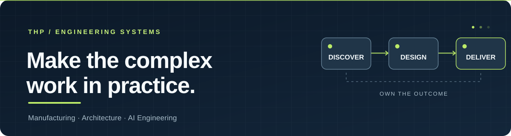

  
  <h1>Hi, I'm Thitipat ("Best")</h1>
  
<strong>Principal Software Engineer · Problem Solver · Systems Builder</strong>

  
I turn ambiguous, real-world problems into software systems people can actually use.

  

    <a href="https://thp-thitipat-cv.vercel.app/"><strong>Portfolio &amp; CV</strong></a> ·
    <a href="https://www.linkedin.com/in/thitipat-pengruean-451ba9138/"><strong>LinkedIn</strong></a> ·
    <a href="mailto:dev.thitipat@gmail.com"><strong>Email</strong></a>
  

  

    <a href="#about">About</a> ·
    <a href="#real-world-impact">Real-world impact</a> ·
    <a href="#projects">Projects</a> ·
    <a href="#tech-stack">Tech stack</a> ·
    <a href="#connect">Connect</a>
  

---

## About

I'm a **Principal Software Engineer at Microchip Technology**, based in Thailand, with **10 years of experience** working at the intersection of software, semiconductor manufacturing, and business operations.

My work starts before the first line of code: understanding how people work, identifying the real constraint, shaping requirements, designing a solution, and carrying it through integration, deployment, training, and improvement.

I care less about the title of the technology and more about whether the solution **solves the right problem, works in production, and stays useful**.

**Where I focus:** manufacturing digitalization · end-to-end solution ownership · data-intensive applications · AI engineering and agent systems.

## Real-world impact

Some of my most meaningful work lives inside production environments rather than public GitHub repositories.

- **Digital manufacturing:** Initiated and led the evolution of paper-based manufacturing records into electronic workflows, including cross-team coordination and multi-site rollout in Thailand and the Philippines.
- **Production traceability:** Developed solutions around manufacturing records, strip-level mapping, process and quality data, and operational integrations.
- **Planning and material visibility:** Built systems that bring fragmented factory and business data together to support clearer, faster decisions.

**My working loop:** Discover the problem → Define the requirements → Design the system → Build and integrate → Deploy and learn.

> Enterprise systems and their source code remain private. The projects below are public work I can share.

## Projects

### AI engineering, agents & developer workflows

| Project | Why I built it |
| :--- | :--- |
| **[BA Discovery](https://github.com/b9b4ymiN/ba-discovery)** | A structured business-analysis skill suite for AI coding workflows: clarify the problem, maintain traceable decisions, and produce an approved FRD *before* implementation. |
| **[zcrew](https://github.com/b9b4ymiN/zcrew)** | A multi-agent coding workflow where Claude Code or Codex plans and reviews while ZCode workers implement, with feedback loops for corrections. |
| **[brain-mcp](https://github.com/b9b4ymiN/brain-mcp)** | A Git-backed MCP knowledge engine for durable agent memory, searchable knowledge, relationships, and auditable changes. |
| **[JellyCore](https://github.com/b9b4ymiN/JellyCore)** | A self-hosted AI assistant platform combining persistent memory, multi-channel orchestration, isolated execution, and an operations UI. |
| **[best-brain](https://github.com/b9b4ymiN/best-brain)** | An evolving, local-first AI work system focused on mission management, worker coordination, and evidence-based completion. |

### Investment research & knowledge tools

| Project | What it explores |
| :--- | :--- |
| **[midas](https://github.com/b9b4ymiN/midas)** | Research skills that move from financial evidence to valuation, long-term business quality, risk, and a reviewable investment thesis. |
| **[one4all](https://github.com/b9b4ymiN/one4all)** | An AI investment research war room with specialized agents, structured debate, evidence checks, and decision governance. |
| **[bothBook](https://github.com/b9b4ymiN/bothBook)** | A lightweight, public knowledge-sharing site built as an online book. [Read it here](https://b9b4ymin.github.io/bothBook/). |

*I build across domains, but the through-line is the same: turn scattered information and unclear requirements into systems that support better decisions.*

## Tech stack

| Area | Tools & technologies |
| :--- | :--- |
| **Applications & backend** | C#, .NET, ASP.NET, WPF, TypeScript, JavaScript, React, Next.js |
| **Data & integration** | Oracle Database, SQL Server, SQLite, REST APIs, system integration |
| **Infrastructure & delivery** | Windows Server, IIS, Linux, Docker, Git, CI/CD, Azure DevOps |
| **AI & automation** | MCP, AI agent orchestration, local LLMs, RAG/knowledge systems, n8n, Python, Rust |

I choose the stack based on the problem, existing constraints, and long-term maintainability—not the other way around.

## Connect

I'm interested in **digital manufacturing, solution architecture, practical AI systems, and engineering workflows that make teams more effective**.

- **[Portfolio / CV](https://thp-thitipat-cv.vercel.app/)** — professional background and selected work
- **[LinkedIn](https://www.linkedin.com/in/thitipat-pengruean-451ba9138/)** — connect professionally
- **[Email](mailto:dev.thitipat@gmail.com)** — reach out directly

  
GitHub activity

  

    
  

  Understand the problem. Own the outcome. Keep improving.

