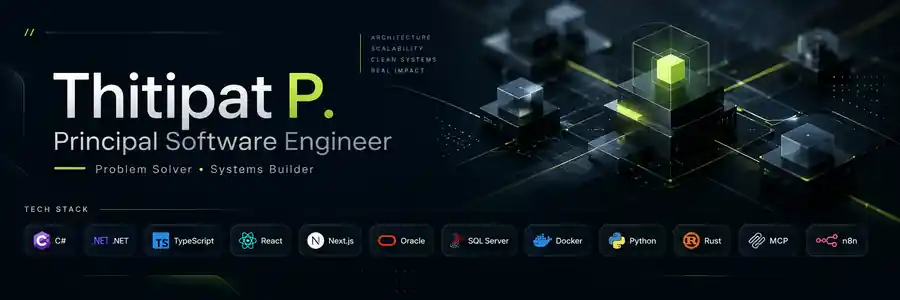

  

  
<strong>Building practical systems from complex, real-world problems.</strong>

  

    
    
    
  

  

    <a href="#about">About</a> ·
    <a href="#real-world-impact">Impact</a> ·
    <a href="#projects">Projects</a> ·
    <a href="#tech-stack">Tech Stack</a> ·
    <a href="#connect">Connect</a>
  

  

---

## 🧭 About

I'm **Thitipat P.**, a **Principal Software Engineer** based in Thailand, with **10 years of experience** across software engineering, semiconductor manufacturing, and business operations.

I work across the full lifecycle: **discover the real problem → define the requirements → design the system → build and integrate → deploy, verify, and improve**.

The goal is never just to ship code. It's to build systems that solve the right problem, survive real-world constraints, and make people's work better.

**Current interests:** solution architecture · manufacturing digitalization · AI engineering · developer workflows · knowledge systems.

## 🏭 Real-world impact

Some of my most meaningful engineering work runs inside production environments rather than public repositories.

| Focus | Contribution |
| :--- | :--- |
| 📋 **Digital manufacturing** | Initiated and led the move from paper-based records to electronic workflows, coordinating teams and multi-site rollouts across Thailand and the Philippines. |
| 🧬 **Production traceability** | Built systems around manufacturing records, strip-level mapping, process and quality data, and operational integrations. |
| 📊 **Planning & material visibility** | Connected fragmented manufacturing and business data into tools that support clearer operational decisions. |

> Production systems and proprietary source code stay private. The repositories below showcase public work.

## 🧩 Selected projects

### 🤖 AI engineering & agent workflows

| Project | What it solves |
| :--- | :--- |
| 🧭 **[BA Discovery](https://github.com/b9b4ymiN/ba-discovery)** | A business-analysis skill suite for turning uncertain ideas into clear, traceable requirements and an approved FRD before coding starts. |
| ⚙️ **[zcrew](https://github.com/b9b4ymiN/zcrew)** | An AI coding workflow: Claude Code or Codex plans and reviews while ZCode workers implement and revise. |
| 🧠 **[brain-mcp](https://github.com/b9b4ymiN/brain-mcp)** | A Git-backed MCP knowledge engine with durable agent memory, search, relationships, and auditability. |
| 🪼 **[JellyCore](https://github.com/b9b4ymiN/JellyCore)** | A self-hosted assistant platform with persistent memory, multi-channel orchestration, isolated execution, and an operations UI. |
| 🛠️ **[best-brain](https://github.com/b9b4ymiN/best-brain)** | A local-first AI work system exploring mission management, worker coordination, and evidence-based completion. |

### 📈 Investment research & knowledge

| Project | What it explores |
| :--- | :--- |
| 🐼 **[midas](https://github.com/b9b4ymiN/midas)** | Evidence-driven investment research skills for valuation, long-term business quality, risk, and thesis review. |
| 🏛️ **[one4all](https://github.com/b9b4ymiN/one4all)** | A multi-agent investment research war room with structured debate and decision governance. |
| 📚 **[bothBook](https://github.com/b9b4ymiN/bothBook)** | A lightweight online knowledge-sharing book. [Open the live site ↗](https://b9b4ymin.github.io/bothBook/). |

## 🧰 Tech stack

### Applications & languages

  

C# / .NET · ASP.NET · WPF · TypeScript · React · Next.js · Python · Rust

### Data & systems

  
  &nbsp;&nbsp;
  
  &nbsp;&nbsp;
  

Oracle Database · SQL Server · SQLite · REST APIs · data integration

### Infrastructure & delivery

  

Windows Server / IIS · Linux · Docker · Git · CI/CD · Azure DevOps

### AI & automation

  
  
  
  
  

*I select tools for the constraints, not the trend—and optimize for reliability, maintainability, and measurable value.*

## ✉️ Connect

I'm interested in **digital manufacturing, solution architecture, practical AI systems, and developer workflows**.

  
  
  

  
📊 GitHub activity

  

    
  

  Understand the problem. Own the outcome. Keep improving.

